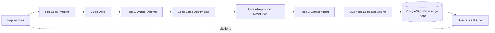

# Vulgata

**Turn cross-repository source code into traceable business knowledge.**

[简体中文](README.zh-CN.md) · [Product requirements](docs/bmad/planning-artifacts/prds/prd-vulgata-2026-06-12/prd.md) · [Architecture](docs/bmad/planning-artifacts/architecture/scanning-v1-technical-plan.md)

Vulgata is an LLM-powered codebase knowledge platform for organizations whose business rules are spread across many systems, repositories, languages, and teams.

It reads source code as the source of truth, generates structured Code Logic Documents and Business Logic Documents, connects evidence across Repository boundaries, and answers questions with citations back to the exact source.

## Why Vulgata

A single business flow may cross a web application, several services, a message queue, and a mobile client. No individual or document usually contains the complete picture, and manually maintained documentation quickly becomes stale.

Vulgata helps product managers, business analysts, compliance staff, new team members, and developers answer a harder question than “where is this symbol?”:

> What actually happens when a user performs this business action, across every system involved?

## What makes it different

- **Business logic, not just code search.** Pass 1 explains bounded Code Units; Pass 2 synthesizes end-to-end business flows from verified evidence.
- **Deterministic orchestration.** A non-LLM Orchestrator owns scheduling, concurrency, retries, and persistence. LLM Worker Agents only perform bounded analysis and synthesis.
- **Source-grounded answers.** Documents retain the Repository revision, file path, symbol, line range, and hash needed to trace a claim back to code.
- **Cross-Repository understanding.** RPC and HTTP evidence can be resolved from consumer to provider while unresolved targets remain explicit Uncertainties.
- **Two audiences, one knowledge base.** Business Mode favors clear process narratives; IT Mode exposes call chains, implementation detail, and source locators.
- **Private deployment.** OpenAI-compatible and self-hosted providers are supported so sensitive source can remain inside the organization.

## How it works



1. **Profile.** CodeGraphContext and conservative filters identify languages, frameworks, symbols, dependencies, and exact Code Unit boundaries.
2. **Explain.** Pass 1 Worker Agents generate Code Logic Documents from revision-bound source slices.
3. **Connect.** Deterministic resolution links supported communication evidence across Repositories and preserves unresolved cases.
4. **Synthesize.** Pass 2 Worker Agents turn prepared flow evidence into Business Logic Documents with explicit provenance.
5. **Ask.** The Chat Agent retrieves only authorized, current evidence and returns a grounded answer with Document and source citations.

Generated Document Versions are immutable. Re-scanning creates a new version instead of silently rewriting history, preserving the evidence chain behind each answer.

## Competition demonstration slice

The August 15 demonstration slice prioritizes one complete, inspectable path over broad but shallow feature coverage.

**Implemented baseline**

- ASP.NET Core Identity, role-based access, and System ownership
- System, Repository, supplementary context, LLM Provider, and database connection management
- CodeGraphContext-backed profiling, language/framework detection, and conservative pre-scan review
- PostgreSQL knowledge storage, retrieval projection, Source Anchors, and immutable Document Versions
- Sequential typed Worker Agent dispatch and two-pass demo document generation
- Exact RPC/HTTP Cross-Repository Resolution for the prepared two-Repository flow

**Final release gate under review**

- Business and IT chat grounded in current authorized evidence
- Document and source citations, including positive line ranges
- Clean PostgreSQL 17, two-Repository, Docker, and browser-level release proof

**Post-competition roadmap**

- General flow discovery and broader communication-pattern coverage
- Incremental re-scan, impact analysis, and stale-document regeneration
- Human-in-the-Loop questions and resolution workflows
- Live Scan dashboard and knowledge graph visualization
- Service-topology MCP integration and advanced retrieval

The canonical status is maintained in [sprint-status.yaml](docs/bmad/implementation-artifacts/sprint-status.yaml). Planned capabilities are not presented as completed features.

## Quick start with Docker

### Prerequisites

- Docker Desktop with Linux containers
- Git
- Network access for the first image build

```powershell
git clone https://github.com/ZHdpt/vulgata.git
cd vulgata
Copy-Item .env.example .env
docker compose up --build
```

Open <http://localhost:8080>. The first registered account is promoted to Administrator so the initial System, Repository, and LLM Provider configuration can be completed through the UI.

The default database password is for development only. Change `DB_PASSWORD` in `.env` before using any shared environment.

The first Docker build installs the hash-locked CodeGraphContext runtime and .NET dependencies, so it can take longer than later builds.

Stop the stack with:

```powershell
docker compose down
```

Add `--volumes` only when you intentionally want to remove the local PostgreSQL data volume.

## Local development

Vulgata targets .NET 10 and expects PostgreSQL 17 on `localhost:5432` with the development connection settings in `appsettings.json`.

```powershell
docker compose up -d postgres
dotnet run --project src/dotnet/Vulgata.Web/Vulgata.Web.csproj
```

Database migrations and role seeding run automatically at startup. The application fails fast if either step cannot complete.

Run the automated test suite with:

```powershell
dotnet test tests/Vulgata.Tests/Vulgata.Tests.csproj
```

## Architecture

| Area | Technology and responsibility |
|---|---|
| Web | .NET 10, ASP.NET Core, Blazor interactive server rendering, Fluent UI Blazor |
| Agents | Microsoft Agent Framework with OpenAI-compatible Worker and Chat Agents |
| Orchestration | Deterministic Scan runner with typed jobs and bounded LLM work |
| Source structure | Hash-locked CodeGraphContext runtime with exact revision and source boundaries |
| Persistence | PostgreSQL 17, EF Core, Npgsql, immutable Document Versions, relational graph edges |
| Security | ASP.NET Core Identity, scoped authorization, Data Protection encryption for provider secrets |
| Deployment | One application container plus PostgreSQL through Docker Compose |

PostgreSQL is both the canonical knowledge store and the document graph. Typed adjacency edges and recursive queries provide traversal and provenance without requiring a separate graph database for the V1 scale.

## Repository layout

```text
src/dotnet/
├── Vulgata.Core/            Domain entities and service contracts
├── Vulgata.Infrastructure/  EF Core, PostgreSQL, Git, profiling, retrieval
├── Vulgata.Agents/          Worker/Chat execution and embedded prompts
├── Vulgata.Shared/          DTOs, validators, policies, shared contracts
├── Vulgata.Web.ViewModels/  UI state and presentation logic
└── Vulgata.Web/             Blazor host, pages, APIs, authentication

tests/Vulgata.Tests/         Unit, integration, contract, and release-gate tests
docs/                        Product, architecture, domain, and delivery documents
specs/                       Story-level SpecKit artifacts
docker/                      Reproducible application image and profiling runtime
```

## Design principles

- Source code is higher-authority evidence than generated prose or human assumptions.
- Unknown relationships are stored as first-class Uncertainties, not hidden by missing rows.
- Authorization is rechecked before evidence is rendered, not only when retrieval begins.
- Agent prompts are externalized and versioned; orchestration decisions remain deterministic.
- Sensitive credentials are encrypted at rest and never belong in generated evidence.

## Project documentation

- [Product Requirements Document](docs/bmad/planning-artifacts/prds/prd-vulgata-2026-06-12/prd.md)
- [Scanning V1 Technical Plan](docs/bmad/planning-artifacts/architecture/scanning-v1-technical-plan.md)
- [Scanning V1 Data Contracts](docs/bmad/planning-artifacts/architecture/scanning-v1-data-contracts.md)
- [Canonical Ubiquitous Language](docs/UBIQUITOUS_LANGUAGE.md)
- [Epics and Stories](docs/bmad/epics.md)

Vulgata aims to close—and keep closed—the gap between what an organization believes its systems do and what the source code actually does.
