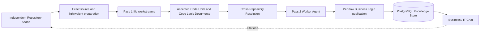

# Vulgata

**Turn cross-repository source code into traceable business knowledge.**

[简体中文](README.zh-CN.md) · [Product requirements](docs/bmad/planning-artifacts/prds/prd-vulgata-2026-06-12/prd.md) · [Architecture](docs/bmad/planning-artifacts/architecture.md)

Vulgata is an LLM-powered codebase knowledge platform for organizations whose business rules are spread across many systems, repositories, languages, and teams.

The target product reads source, generates structured Code Logic Documents and Business Logic Documents, connects evidence across Repository boundaries, and answers wiki questions with useful version-bound references. The generic workflow is under development; the capabilities below describe its adopted direction, not a completed release.

## Why Vulgata

A single business flow may cross a web application, several services, a message queue, and a mobile client. No individual or document usually contains the complete picture, and manually maintained documentation quickly becomes stale.

Vulgata helps product managers, business analysts, compliance staff, new team members, and developers answer a harder question than “where is this symbol?”:

> What actually happens when a user performs this business action, across every system involved?

## What makes it different

- **Business logic, not just code search.** Pass 1 analyzes whole-file workstreams and discovers meaningful Code Units; Pass 2 explains source-backed Logical Flows with explicit gaps.
- **Deterministic orchestration.** Scan Control owns scheduling and recovery; Knowledge owns accepted semantic records. Microsoft Agent Framework executes bounded analysis and synthesis.
- **Source-grounded answers.** Documents retain the Repository revision, file path, symbol, line range, and hash needed to trace a claim back to code.
- **Cross-Repository understanding.** Independently scanned Repositories contribute communication evidence; bounded reconciliation handles late targets and cycles while preserving Uncertainties.
- **Two audiences, one knowledge base.** Business Mode reads Business Logic Documents only. IT Mode also uses Code Logic Documents and exceptional authorized source inspection. Both support useful multi-document dialogue and references.
- **Private deployment.** OpenAI-compatible and self-hosted providers are supported so sensitive source can remain inside the organization.

## Target workflow



1. **Prepare.** Retain an exact Git revision, inventory eligible source, capture advisory context and prepare native CodeGraph MCP and the selected LSP profile. PreScan does not define permanent Code Unit identities.
2. **Explain.** Pass 1 processes admitted files progressively and publishes accepted semantic-unit Documents, with coverage gaps reported separately.
3. **Connect.** Reconcile pinned accepted evidence across authorized Repositories; missing external information does not become an invented relationship.
4. **Synthesize.** Explain local or Cross-Repository Logical Flows and atomically publish each flow with its exact dependencies.
5. **Ask.** Read a stable authorized wiki selection per turn and stream useful provisional answers. Preserve durable dialogue, exact references and honest interruption states.

Generated Document Versions remain immutable. Accepted source analysis or changed accepted flow evidence can produce new versions without rewriting history. Bounded knowledge reconciliation is separate from the deferred automatic source-update engine.

## Current state and delivery scope

The September 11 planning correction adopts the [generic architecture](docs/bmad/planning-artifacts/architecture/ARCHITECTURE-SPINE.md). It replaces competition-specific future delivery rules, not historical evidence or implementation automatically.

**Implemented baseline**

- ASP.NET Core Identity, role-based access, and System ownership
- System, Repository, supplementary context, LLM Provider, and database connection management
- PostgreSQL knowledge storage, retrieval projection, Source Anchors, and immutable Document Versions
- Durable prepared Scan/Pass 1/Pass 2 and exact-pair resolution assets, plus Chat transport and retrieval code that require adaptation

**Not a completed generic release**

- Executable CodeGraphContext was removed; the legacy Repository profiling entry intentionally throws `NotImplementedException`.
- Existing prepared stages and Chat are not yet the new end-to-end, generic source-to-wiki workflow.
- Story 11.5 is incomplete. Story 12.5 was terminated incomplete; it is not a release gate awaiting automatic resumption.
- Native tools bundled in Docker, persistent exact source, generic reconciliation, new Chat streaming and coherent recovery need new implementation qualification.

**Current direction and explicit later scope**

- Current: independent Repository/standalone Scans, semantic-unit knowledge, Cross-Repository understanding, multi-document streaming Chat, real Scan progress, version-aware reader and basic manual-refresh graph.
- Deferred: automatic/incremental scans, product HITL, Chat attachments, partial library scans, external operational lookup, outward wiki MCP and advanced/live portfolio graph.
- Original unmet backlog such as Prompt Workbench and general custom MCP management remains explicitly tracked; the core sequence does not claim full-V1 completion.

Use the [approved reconciliation](docs/bmad/planning-artifacts/sprint-change-proposal-2026-09-11-generic-product-reconciliation.md), [epics](docs/bmad/epics.md) and [sprint tracker](docs/bmad/implementation-artifacts/sprint-status.yaml) for adoption and queue status. Earlier release records remain [historical](docs/bmad/history/pre-generic-adoption-2026-09-11/README.md).

## Run the existing Docker baseline

This starts the existing application baseline, not a qualified generic scanning stack. The target is two services—app with bundled local tools, and PostgreSQL—but current Docker packaging still needs that delivery work. Without the explicit application profile, Compose starts PostgreSQL only.

### Prerequisites

- Docker Desktop with Linux containers
- Git
- Network access for the first image build

```powershell
git clone https://github.com/ZHdpt/vulgata.git
cd vulgata
Copy-Item .env.example .env
docker compose --profile post-deadline-app up --build
```

Open <http://localhost:8080>. The first registered account is promoted to Administrator so the initial System, Repository, and LLM Provider configuration can be completed through the UI.

The default database password is for development only. Change `DB_PASSWORD` in `.env` before using any shared environment.

The current image does not install CGC and does not yet bundle the target CodeGraph/JDT-LS runtime. Build/start instructions are not evidence that Scan or provider prerequisites are ready.

Stop the stack with:

```powershell
docker compose --profile post-deadline-app down
```

Add `--volumes` only when you intentionally want to remove the local PostgreSQL data volume.

## Local development

Vulgata targets .NET 10 and expects PostgreSQL 17 on `localhost:5432` with the development connection settings in `appsettings.json`. The following remains a baseline diagnostic workflow; the adopted development target is the bundled-tool Docker stack.

```powershell
docker compose up -d postgres
dotnet run --project src/dotnet/Vulgata.Web/Vulgata.Web.csproj
```

Database migrations and role seeding run automatically at startup. The application fails fast if either step cannot complete.

Run the automated test suite with:

```powershell
dotnet test tests/Vulgata.Tests/Vulgata.Tests.csproj
```

## Architecture

| Area | Technology and responsibility |
|---|---|
| Web | .NET 10, ASP.NET Core, Blazor interactive server rendering, Fluent UI Blazor |
| Agents | Microsoft Agent Framework with OpenAI-compatible Worker and Chat Agents |
| Orchestration target | Deterministic Scan Control, Knowledge-owned acceptance and bounded MAF work |
| Source/tool target | Retained exact source, native CodeGraph MCP, selected snapshot-bound LSP; temporary no-import/no-restore profile |
| Persistence | PostgreSQL 17, EF Core, Npgsql, immutable Document Versions, relational graph edges |
| Security | ASP.NET Core Identity, scoped authorization, Data Protection encryption for provider secrets |
| Deployment target | One application container with local tools plus PostgreSQL; configurable storage/limits and coherent backup/restore |

PostgreSQL is both the canonical knowledge store and the document graph. Typed adjacency edges and recursive queries provide traversal and provenance without requiring a separate graph database for the V1 scale.

## Repository layout

```text
src/dotnet/
├── Vulgata.Core/            Domain entities and service contracts
├── Vulgata.Infrastructure/  EF Core, PostgreSQL, Git, profiling, retrieval
├── Vulgata.Agents/          Worker/Chat execution and embedded prompts
├── Vulgata.Shared/          DTOs, validators, policies, shared contracts
├── Vulgata.Web.ViewModels/  UI state and presentation logic
└── Vulgata.Web/             Blazor host, pages, APIs, authentication

tests/Vulgata.Tests/         Unit, integration, contract, and release-gate tests
docs/                        Product, architecture, domain, and delivery documents
specs/                       Story-level SpecKit artifacts
docker/                      Reproducible application image and profiling runtime
```

## Design principles

- Source code is higher-authority evidence than generated prose or human assumptions.
- Unknown relationships are stored as first-class Uncertainties, not hidden by missing rows.
- Authorization is rechecked before evidence is rendered, not only when retrieval begins.
- Agent prompts are externalized and versioned; orchestration decisions remain deterministic.
- Sensitive credentials are encrypted at rest and never belong in generated evidence.

## Project documentation

- [Product Requirements Document](docs/bmad/planning-artifacts/prds/prd-vulgata-2026-06-12/prd.md)
- [Current Architecture](docs/bmad/planning-artifacts/architecture.md)
- [Generic Scan, Knowledge and Chat Spine](docs/bmad/planning-artifacts/architecture/ARCHITECTURE-SPINE.md)
- [Canonical Ubiquitous Language](docs/UBIQUITOUS_LANGUAGE.md)
- [Epics and Stories](docs/bmad/epics.md)

Vulgata aims to close—and keep closed—the gap between what an organization believes its systems do and what the source code actually does.
