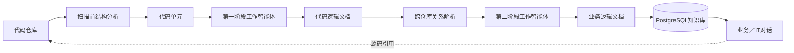

# Vulgata

**将跨仓库源代码转化为可追溯的业务知识。**

[English](README.md) · [产品需求文档](docs/bmad/planning-artifacts/prds/prd-vulgata-2026-06-12/prd.md) · [技术架构](docs/bmad/planning-artifacts/architecture/scanning-v1-technical-plan.md)

Vulgata是一款面向大型组织的LLM代码知识库平台，帮助用户理解分散在多套系统、多个代码仓库、不同语言和团队中的真实业务逻辑。

它以源代码为事实依据，生成结构化的代码逻辑文档与业务逻辑文档，连接跨仓库证据，并通过对话给出能够回溯到具体源码位置的答案。

## 为什么需要Vulgata

一个业务流程可能同时经过Web应用、多个服务、消息队列和移动客户端。通常没有任何个人或文档掌握完整链路，人工维护的说明也会随着代码变更迅速过时。

Vulgata面向产品经理、业务分析师、合规人员、新员工和开发者，回答的不只是“某个符号在哪里”，而是一个更重要的问题：

> 当用户执行某项业务操作时，所有相关系统实际上发生了什么？

## 核心特点

- **理解业务，而非只搜索代码。** 第一阶段解释边界明确的代码单元，第二阶段从经过验证的证据中归纳端到端业务流程。
- **确定性编排。** 非LLM编排器负责调度、并发、重试和持久化；LLM工作智能体只执行范围受限的分析与综合任务。
- **结论可追溯。** 文档保留仓库版本、文件路径、符号、代码行范围和哈希，使每项关键结论都能回到源码验证。
- **跨仓库理解。** 系统能够解析RPC和HTTP调用的消费方与提供方；尚未找到目标的关系会作为未决项明确保存。
- **同一知识库服务两类用户。** 业务模式提供易懂的流程叙述，IT模式展示调用链、实现细节和源码位置。
- **支持私有化部署。** 可接入OpenAI兼容服务或组织内部模型，敏感源代码无需离开内网。

## 工作原理



1. **结构分析。** CodeGraphContext配合保守过滤策略识别语言、框架、符号、依赖以及精确的代码单元边界。
2. **代码解释。** 第一阶段工作智能体读取绑定到指定Git版本的源码片段，生成代码逻辑文档。
3. **关系连接。** 确定性解析服务连接跨仓库通信证据，并保留暂时无法解析的关系。
4. **业务综合。** 第二阶段工作智能体根据准备好的流程证据生成业务逻辑文档，并记录完整来源链。
5. **知识问答。** 对话智能体只检索当前用户有权访问且仍然有效的证据，答案附带文档和源码引用。

生成的文档版本不可变。重新扫描会创建新版本，而不是静默改写旧内容，因此每次回答背后的证据链都可以被保留和审计。

## 竞赛演示范围

8月15日竞赛演示版本优先完成一条真实、完整、可检查的端到端路径，而不是提供大量但浅层的功能。

**已实现的基础能力**

- ASP.NET Core Identity、角色权限与系统所有权管理
- 系统、仓库、补充上下文、LLM服务及数据库连接管理
- 基于CodeGraphContext的仓库分析、语言／框架识别和保守扫描前审查
- PostgreSQL知识存储、检索投影、源码锚点和不可变文档版本
- 顺序执行的类型化工作智能体调度，以及两阶段演示文档生成
- 面向准备好的双仓库流程进行精确RPC／HTTP跨仓库关系解析

**正在进行最终评审的发布门禁**

- 基于当前授权证据的业务模式与IT模式对话
- 文档与源码引用，包括有效的代码行范围
- 全新PostgreSQL 17数据库、双仓库、Docker及浏览器级发布验证

**赛后路线图**

- 通用业务流程发现及更多通信模式识别
- 增量扫描、影响分析与过期文档再生成
- 人机协同问题确认与未决项处理流程
- 实时扫描看板与知识图谱可视化
- 服务拓扑MCP集成及更高级的检索能力

项目的权威进度记录位于[sprint-status.yaml](docs/bmad/implementation-artifacts/sprint-status.yaml)。README不会把规划中的能力描述成已经完成的功能。

## 使用Docker快速启动

### 环境要求

- 使用Linux容器的Docker Desktop
- Git
- 首次构建镜像时能够访问依赖源

```powershell
git clone https://github.com/ZHdpt/vulgata.git
cd vulgata
Copy-Item .env.example .env
docker compose up --build
```

打开<http://localhost:8080>。第一个注册账号会自动获得管理员角色，可通过界面完成系统、仓库和LLM服务的初始配置。

默认数据库密码仅供本地开发使用。在共享环境中运行前，请修改`.env`中的`DB_PASSWORD`。

首次构建需要安装经过哈希锁定的CodeGraphContext运行时和.NET依赖，因此可能比后续构建耗时更长。

停止服务：

```powershell
docker compose down
```

只有在确定需要删除本地PostgreSQL数据卷时，才应添加`--volumes`参数。

## 本地开发

Vulgata使用.NET 10，默认连接`localhost:5432`上的PostgreSQL 17。开发连接配置位于`appsettings.json`。

```powershell
docker compose up -d postgres
dotnet run --project src/dotnet/Vulgata.Web/Vulgata.Web.csproj
```

应用启动时会自动执行数据库迁移和角色初始化；任何步骤失败都会阻止应用在不完整状态下继续运行。

运行自动化测试：

```powershell
dotnet test tests/Vulgata.Tests/Vulgata.Tests.csproj
```

## 技术架构

| 领域 | 技术与职责 |
|---|---|
| Web | .NET 10、ASP.NET Core、Blazor交互式服务端渲染、Fluent UI Blazor |
| 智能体 | Microsoft Agent Framework及OpenAI兼容的工作／对话智能体 |
| 编排 | 采用类型化任务和受限LLM工作的确定性扫描执行器 |
| 源码结构 | 哈希锁定的CodeGraphContext运行时、精确Git版本及源码边界 |
| 持久化 | PostgreSQL 17、EF Core、Npgsql、不可变文档版本和关系型图边 |
| 安全 | ASP.NET Core Identity、范围化授权、Data Protection密钥加密 |
| 部署 | 通过Docker Compose运行单个应用容器与PostgreSQL |

PostgreSQL同时承担权威知识库和文档图谱的职责。类型化邻接边与递归查询提供关系遍历和来源追踪，V1无需额外引入图数据库。

## 项目结构

```text
src/dotnet/
├── Vulgata.Core/            领域实体与服务契约
├── Vulgata.Infrastructure/  EF Core、PostgreSQL、Git、结构分析与检索
├── Vulgata.Agents/          工作／对话智能体执行及嵌入式提示词
├── Vulgata.Shared/          DTO、验证器、权限策略与共享契约
├── Vulgata.Web.ViewModels/  UI状态与表现逻辑
└── Vulgata.Web/             Blazor宿主、页面、API与身份认证

tests/Vulgata.Tests/         单元、集成、契约及发布门禁测试
docs/                        产品、架构、领域及交付文档
specs/                       Story级SpecKit工件
docker/                      可复现应用镜像及结构分析运行时
```

## 设计原则

- 源代码的证据优先级高于生成文本和人工假设。
- 未知关系必须保存为一等未决项，不能因数据库中“没有记录”而被隐藏。
- 系统在展示证据前重新检查授权，而不只在开始检索时检查一次。
- 智能体提示词独立存储并纳入版本管理，编排决策保持确定性。
- 敏感凭据必须加密保存，且绝不能出现在生成的证据中。

## 项目文档

- [产品需求文档](docs/bmad/planning-artifacts/prds/prd-vulgata-2026-06-12/prd.md)
- [扫描V1技术方案](docs/bmad/planning-artifacts/architecture/scanning-v1-technical-plan.md)
- [扫描V1数据契约](docs/bmad/planning-artifacts/architecture/scanning-v1-data-contracts.md)
- [统一语言表](docs/UBIQUITOUS_LANGUAGE.md)
- [Epic与用户故事](docs/bmad/epics.md)

Vulgata希望持续缩小“组织认为系统如何运行”与“源代码实际如何运行”之间的差距，并最终成为企业软件资产的可信知识底座。
