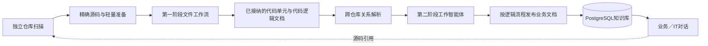

# Vulgata

**将跨仓库源代码转化为可追溯的业务知识。**

[English](README.md) · [产品需求文档](docs/bmad/planning-artifacts/prds/prd-vulgata-2026-06-12/prd.md) · [技术架构](docs/bmad/planning-artifacts/architecture.md)

Vulgata是一款面向大型组织的LLM代码知识库平台，帮助用户理解分散在多套系统、多个代码仓库、不同语言和团队中的真实业务逻辑。

目标产品以源码为依据，生成结构化的代码逻辑文档与业务逻辑文档，连接跨仓库证据，并通过对话提供绑定具体文档版本的引用。通用流程仍在开发中；以下介绍的是已采纳的产品方向，而非已经完成的发布版本。

## 为什么需要Vulgata

一个业务流程可能同时经过Web应用、多个服务、消息队列和移动客户端。通常没有任何个人或文档掌握完整链路，人工维护的说明也会随着代码变更迅速过时。

Vulgata面向产品经理、业务分析师、合规人员、新员工和开发者，回答的不只是“某个符号在哪里”，而是一个更重要的问题：

> 当用户执行某项业务操作时，所有相关系统实际上发生了什么？

## 核心特点

- **理解业务，而非只搜索代码。** 第一阶段按完整文件工作流识别有意义的代码单元，第二阶段解释有源码依据的逻辑流程，并明确保留信息缺口。
- **确定性编排。** Scan Control负责调度与恢复，Knowledge负责语义结果接纳；Microsoft Agent Framework执行范围受限的分析与综合。
- **结论可追溯。** 文档保留仓库版本、文件路径、符号、代码行范围和哈希，使每项关键结论都能回到源码验证。
- **跨仓库理解。** 独立扫描的仓库提供通信证据；有界的关系协调处理后续加入的目标和循环引用，并保留未决项。
- **同一知识库服务两类用户。** 业务模式只读取业务逻辑文档；IT模式还可读取代码逻辑文档，并在特定缺口下访问授权的精确源码。两者都支持有引用的多文档连续对话。
- **支持私有化部署。** 可接入OpenAI兼容服务或组织内部模型，敏感源代码无需离开内网。

## 目标工作流程



1. **准备。** 保留精确Git版本，列举可分析源码并捕获辅助上下文，准备原生CodeGraph MCP及选定LSP配置。预扫描不决定永久代码单元身份。
2. **解释。** 第一阶段渐进处理纳入范围的文件，接纳语义代码单元文档；覆盖缺口单独报告。
3. **连接。** 在授权仓库范围内协调绑定版本的已接纳证据，缺失的外部信息不会被编造成确定关系。
4. **综合。** 解释仓库内部或跨仓库逻辑流程，按流程原子发布文档及其精确依赖。
5. **问答。** 每一轮对话使用稳定的授权知识视图，实时输出暂定答案，并保留持久会话、精确引用和明确的中断状态。

生成的文档版本不可变。新的源码分析或已接纳流程证据变化可以产生新版本，而不改写历史。有界的知识协调不等于自动更新源码扫描；后者仍属延期范围。

## 当前状态与交付范围

9月11日规划调整采纳了[通用架构](docs/bmad/planning-artifacts/architecture/ARCHITECTURE-SPINE.md)，替换未来交付中的竞赛专用规则，但不会自动改变历史证据或现有实现。

**已实现的基础能力**

- ASP.NET Core Identity、角色权限与系统所有权管理
- 系统、仓库、补充上下文、LLM服务及数据库连接管理
- PostgreSQL知识存储、检索投影、源码锚点和不可变文档版本
- 可复用但需要适配的持久化准备扫描、Pass 1、Pass 2、精确双仓库解析，以及对话传输和检索代码

**尚未形成完整通用版本**

- 可执行的CodeGraphContext已移除，旧仓库分析入口有意抛出`NotImplementedException`。
- 现有准备阶段与对话实现尚未组成新的通用源码到知识库端到端流程。
- Story 11.5未完成；Story 12.5已在未完成状态下终止，不是等待自动恢复的发布门禁。
- Docker内置原生工具、精确源码保留、通用关系协调、新对话流式机制和一致恢复仍需实施与验证。

**当前方向与明确延期范围**

- 当前：独立仓库与独立库扫描、语义代码单元知识、跨仓库理解、多文档流式对话、真实扫描进度、版本化文档阅读和基本手动刷新图谱。
- 延期：自动／增量扫描、产品HITL、对话附件、局部库扫描、外部运行信息查询、对外知识MCP和高级／实时全局图谱。
- 提示词工作台及通用自定义MCP管理等原有未完成功能继续明确记录；核心交付序列不代表完整V1全部完成。

采用与队列状态参见[已批准调整](docs/bmad/planning-artifacts/sprint-change-proposal-2026-09-11-generic-product-reconciliation.md)、[Epic](docs/bmad/epics.md)及[扫描交付跟踪](docs/bmad/implementation-artifacts/sprint-status.yaml)。此前发布记录保留为[历史](docs/bmad/history/pre-generic-adoption-2026-09-11/README.md)。

## 运行现有Docker基线

以下命令启动现有应用基线，不代表通用扫描栈已通过验证。目标是两个服务：包含本地工具的应用与PostgreSQL；当前Docker打包仍需完成对应交付。不显式启用应用profile时，Compose仅启动PostgreSQL。

### 环境要求

- 使用Linux容器的Docker Desktop
- Git
- 首次构建镜像时能够访问依赖源

```powershell
git clone https://github.com/ZHdpt/vulgata.git
cd vulgata
Copy-Item .env.example .env
docker compose --profile post-deadline-app up --build
```

打开<http://localhost:8080>。第一个注册账号会自动获得管理员角色，可通过界面完成系统、仓库和LLM服务的初始配置。

默认数据库密码仅供本地开发使用。在共享环境中运行前，请修改`.env`中的`DB_PASSWORD`。

当前镜像不再安装CGC，也尚未包含目标CodeGraph／JDT-LS运行时。构建或启动命令本身不证明扫描工具或模型服务已就绪。

停止服务：

```powershell
docker compose --profile post-deadline-app down
```

只有在确定需要删除本地PostgreSQL数据卷时，才应添加`--volumes`参数。

## 本地开发

Vulgata使用.NET 10，默认连接`localhost:5432`上的PostgreSQL 17。开发连接配置位于`appsettings.json`。以下仍是现有基线的诊断方式；已采纳的开发目标是内置工具的Docker栈。

```powershell
docker compose up -d postgres
dotnet run --project src/dotnet/Vulgata.Web/Vulgata.Web.csproj
```

应用启动时会自动执行数据库迁移和角色初始化；任何步骤失败都会阻止应用在不完整状态下继续运行。

运行自动化测试：

```powershell
dotnet test tests/Vulgata.Tests/Vulgata.Tests.csproj
```

## 技术架构

| 领域 | 技术与职责 |
|---|---|
| Web | .NET 10、ASP.NET Core、Blazor交互式服务端渲染、Fluent UI Blazor |
| 智能体 | Microsoft Agent Framework及OpenAI兼容的工作／对话智能体 |
| 编排目标 | 确定性Scan Control、Knowledge语义接纳与有界MAF工作 |
| 源码／工具目标 | 保留精确源码、原生CodeGraph MCP、绑定快照的选定LSP；暂时禁用自动导入／依赖还原 |
| 持久化 | PostgreSQL 17、EF Core、Npgsql、不可变文档版本和关系型图边 |
| 安全 | ASP.NET Core Identity、范围化授权、Data Protection密钥加密 |
| 部署目标 | 含本地工具的应用容器与PostgreSQL；可配置存储／限额及一致备份恢复 |

PostgreSQL同时承担权威知识库和文档图谱的职责。类型化邻接边与递归查询提供关系遍历和来源追踪，V1无需额外引入图数据库。

## 项目结构

```text
src/dotnet/
├── Vulgata.Core/            领域实体与服务契约
├── Vulgata.Infrastructure/  EF Core、PostgreSQL、Git、结构分析与检索
├── Vulgata.Agents/          工作／对话智能体执行及嵌入式提示词
├── Vulgata.Shared/          DTO、验证器、权限策略与共享契约
├── Vulgata.Web.ViewModels/  UI状态与表现逻辑
└── Vulgata.Web/             Blazor宿主、页面、API与身份认证

tests/Vulgata.Tests/         单元、集成、契约及发布门禁测试
docs/                        产品、架构、领域及交付文档
specs/                       Story级SpecKit工件
docker/                      可复现应用镜像及结构分析运行时
```

## 设计原则

- 源代码的证据优先级高于生成文本和人工假设。
- 未知关系必须保存为一等未决项，不能因数据库中“没有记录”而被隐藏。
- 系统在展示证据前重新检查授权，而不只在开始检索时检查一次。
- 智能体提示词独立存储并纳入版本管理，编排决策保持确定性。
- 敏感凭据必须加密保存，且绝不能出现在生成的证据中。

## 项目文档

- [产品需求文档](docs/bmad/planning-artifacts/prds/prd-vulgata-2026-06-12/prd.md)
- [当前技术架构](docs/bmad/planning-artifacts/architecture.md)
- [通用扫描、知识与对话架构主干](docs/bmad/planning-artifacts/architecture/ARCHITECTURE-SPINE.md)
- [统一语言表](docs/UBIQUITOUS_LANGUAGE.md)
- [Epic与用户故事](docs/bmad/epics.md)

Vulgata希望持续缩小“组织认为系统如何运行”与“源代码实际如何运行”之间的差距，并最终成为企业软件资产的可信知识底座。
