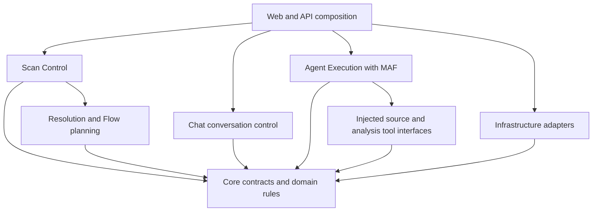

# Vulgata generic Scan, Knowledge and Chat architecture

Repository adoption finalized under the user-approved [September 11 planning correction](../sprint-change-proposal-2026-09-11-generic-product-reconciliation.md), following independent input reconciliation and the configured adoption reviewer gate. The [architecture gateway](../architecture.md) defines the separate authority of product requirements, terminology, architecture, delivery plans and implementation evidence.

The external source was finalized and independently reviewed on September 10 at source baseline `2bb83c3b44fc0afc07ae253ec1df5fab4399b964`; its SHA-256 is `CC7E5AC92810734549607F38399720A027E3E237320ACEC30926FBF24D6FE093`. Its `scan-architecture-2026-09-06/ARCHITECTURE-SPINE.md`, chronological decisions and `reviews/review-summary-final-20260910.md` remain unchanged external provenance, identified by the approved proposal. `[ADOPTED]` records those accepted decisions; all AD-1–AD-32 headings and Binds/Prevents/Rule text are preserved. Only metadata, provenance and scoped adoption wording outside the AD blocks change here. External acceptance preceded repository adoption; neither supplies implementation authority or runtime qualification.

## Design paradigm

Use a modular monolith: Scan Control coordinates durable work; computational modules propose; Infrastructure adapts source/tools/storage; Knowledge owns accepted semantics/read selection; Chat owns conversations/turns; MAF runs model conversations/tools; Web composes/presents. Dependency direction binds; modules need not be separate processes/projects.

## Invariants and rules

### AD-1 — Independent source ownership [ADOPTED]

- **Binds:** Scan initiation, scheduling, version identity.
- **Prevents:** pair-wide correctness identities and global Repository barriers.
- **Rule:** Each Repository Scan Run fixes one Source Snapshot. System/selection actions create independent runs; an optional Scan Campaign owns only batch controls/progress. Standalone Repositories use this pipeline. System membership is organizational, neither communication evidence nor obligatory resolution scope.

### AD-2 — State ownership and composition [ADOPTED]

- **Binds:** all module interfaces and writes.
- **Prevents:** competing writers and workflow logic spread through UI and Workers.
- **Rule:** Scan Control owns Scan requests/plans/jobs/progress; Knowledge owns semantic acceptance and accepted knowledge. Resolver/Flow Planner proposes against supplied accepted evidence. Chat owns conversations/turns, not Scan jobs/wiki publication. Agent Execution uses injected tools/domain contracts, without direct EF or arbitrary filesystem/process access. Infrastructure atomically implements Knowledge acceptance with Scan Control fencing and implements Chat completion (AD-27), without competing acceptance policies. Ordinary modules cannot directly mutate others' tables. Designated domain builders supply public identifiers/canonical fingerprints. The ownership table binds.

### AD-3 — Source Snapshot and Tool Workspace [ADOPTED]

- **Binds:** acquisition, source reads, tool processes and Source Anchors.
- **Prevents:** revision drift, host-path leakage and source/index conflation.
- **Rule:** Initially use committed Git; resolve refs once. Public identity is Repository, full Git commit ID (Profiled Revision), Code Unit/file/range. Source Snapshot provides transparent retained-source/read access, not another public version axis. Ordinary readers use relative metadata/list/range operations under server-issued grants, cumulative budgets/deadlines; only trusted adapters receive contained physical workspace leases. Immutable canonical bytes remain separate from tool state. Retain exact source required by selected current knowledge/active work, including older contributing revisions. Re-materialization verifies identical bytes without new versioning. Historical Documents/provenance survive workspace cleanup; perpetual historical-source retention is separate policy. Durable retention/reopening is a replacement prerequisite, not existing qualification.

### AD-4 — Preparation describes source and establishes tools [ADOPTED]

- **Binds:** PreScan, overview generation and tool readiness.
- **Prevents:** a Repository-specific parser workflow becoming universal preparation.
- **Rule:** PreScan records inventory, format/language/layout facts and unknowns. A bounded LLM overview uses structure/supplied context for hypotheses and ordering, without detailed analysis or coverage authority; store it separately from facts. CodeGraph preparation/native MCP connection are required before Pass 1. LSP follows a declared profile: initial offline/local-source operation is temporary, not permanent topology. Initially allow at most one session per snapshot, whole-Repository workspace and separate state; disable Maven/Gradle import/execution/download. Dependency-aware profiles require separate authorization/qualification and declared inputs. Tool readiness does not prove complete semantic coverage.

### AD-5 — Coverage and structured content [ADOPTED]

- **Binds:** inventory, Scan Work Plan, source-content tools.
- **Prevents:** fixed language/sample limits and silent exclusion of unfamiliar files.
- **Rule:** Explicit Scan policy selects primary/supporting sources. Handwritten source, configuration, templates, schemas and DSLs remain eligible; tests, identifiable generated source and vendored dependencies default to supporting evidence. README/explanatory documents supply context, not automatic Code Logic jobs. Classification needs evidence: filenames or CodeGraph index omission alone do not determine eligibility. Keep unknown classifications/extensions explicit; overview ranking cannot remove admitted files. One extensible Source Content Analysis interface provides format readers/optional dialect interpreters, never configuration execution or external fetching. Preserve useful structure despite unknown meaning, source access for unrecognized syntax, and its distinction from malformed recognized content. Preserve locations; provide compact format summaries and detailed on-demand Pass 1 inspection. No fixed RPC/XML recipe or 50-150-unit quota governs the pipeline; dynamic parser generation/plugin loading is not implied.

### AD-6 — Native agent tooling and application policy [ADOPTED]

- **Binds:** Worker execution and tool invocation.
- **Prevents:** rebuilding native tool exploration or allowing model-selected workspaces.
- **Rule:** MAF owns the normal conversation/tool loop. Expose CodeGraph's native recommended MCP surface for Worker-directed use; bind `projectPath` to the authorized snapshot outside model arguments. Provide language-neutral LSP capabilities and bounded source/content-analysis tools. Models cannot select LSP Adapters/workspaces/snapshots. LSP returns normalized locations/evidence handles, limitations and receipts; scoped reads fetch source. Native CodeGraph may return source under the same authority. Application policy binds scope/budget/provenance. Workers cannot schedule arbitrary Repository work, choose provider credentials or commit domain records. Recover required CodeGraph failures without automatic source-only fallback.

### AD-7 — File work; semantic knowledge [ADOPTED]

- **Binds:** Pass 1 outputs, Code Unit identity and Document ownership.
- **Prevents:** file segments becoming semantic units and duplicate cross-file authorship.
- **Rule:** One logical file workstream discovers meaningful Code Units, each with its own Code Logic Logical Document and immutable versions; no per-unit LLM invocation is required. Other files supply context. Knowledge owns canonical identity; hashes/source/run bindings are server-derived. Nested units/shared anchors are valid, conflicting identities are not. Repository/file/Code Unit browsing does not equate folders or moving ranges with identity. Unproven rename/split/merge mappings cannot silently reuse identity. Unify selectors/nesting/aliases/lineage in one owning contract before builders split. Pass 1 discovers detail; transient CodeGraph IDs/preallocated PreScan symbols are not permanent identity authorities.

### AD-8 — Durable progress and acceptance [ADOPTED]

- **Binds:** large files, retries and evidence eligibility.
- **Prevents:** context limits defining source semantics and partial drafts appearing as knowledge.
- **Rule:** Window large files; continue across completed agent runs as needed. Atomically checkpoint validated drafts with authoritative progress; conversation history only assists recovery. Only accepted staged file manifests expose units/Documents to resolution. Unprocessed required source stays pending; terminal failed files expose no partial drafts as accepted units and declare coverage gaps. Semantic uncertainty may accompany valid acceptance; zero-unit outcomes need truthful dispositions. Fenced idempotent acceptance prevents duplicate knowledge, not external billing. Configurable context/call/cost limits never silently exclude coverage.

### AD-9 — Generic communication and resolution evidence [ADOPTED]

- **Binds:** Pass 1 observations, normalization and matching.
- **Prevents:** fixed demo profiles, invented deployed values and false endpoint identity.
- **Rule:** Observations retain owner, role, mechanism, operation, source literals/expressions, applicable logical namespaces, evidence status and provenance, including unknown mechanisms. Matching records input versions/rule/outcome. A lone visible candidate, shared path, topic name or model confidence cannot alone prove a match. Service identity differs from organizational/access scope. Missing bindings/ambiguous targets become Uncertainties; source-derived linkage does not prove runtime execution. AD-20 bounds investigation; AD-22 bounds facts outside available source/knowledge.

### AD-10 — Bounded reconciliation [ADOPTED]

- **Binds:** new knowledge, reference updates and downstream work.
- **Prevents:** recursive System-to-System cascades and endless regeneration feedback.
- **Rule:** Incrementally reconcile accepted observations against finite pinned targets. Later Repository knowledge can resolve old Uncertainties without re-analyzing unchanged source. Record call cycles; terminate traversal. Deduplicate affected Logical Flows, comparing relevant content/evidence versions and membership. Document publication starts no resolution epoch. Static-scan synthesis requires explicit terminal outcomes for every admitted primary item of the root Repository Scan Run; paused root work does not qualify. Accepted external files may contribute while their Repository runs remain unfinished. Every matching item in the frozen target must finish or receive explicit failure/Uncertainty disposition before synthesis. Show gaps without waiting for all Repositories. Coalesce new checkpoints into one latest unstarted refresh demand per flow; active inputs stay fixed.

### AD-11 — Flow Group identity and membership [ADOPTED]

- **Binds:** root selection and Flow planning.
- **Prevents:** mandatory remote calls, fixed provider-XML traces and undirected graph clustering.
- **Rule:** Roots are source-backed exported operations, handlers, schedules, declarative workflows or selected Code Units. Each retains a distinct Logical Flow identity, initially homed at its root Repository. Business browsing groups Logical Flows through System/Repository views; cross-Repository appearances share one Logical Document. Helpers/folders/strongly connected components do not merge business purpose. Plan bounded directed slices with branches, uncertain frontiers and exact evidence versions; local-only flows qualify. Paths show static evidence, not one proven runtime sequence. Expose bounds/gaps; defer separate-business-root merging.

### AD-12 — Pass 2 synthesizes supported explanations [ADOPTED]

- **Binds:** Business Logic generation and additional evidence.
- **Prevents:** model-created authoritative Edges and hidden dependency expansion.
- **Rule:** A Flow Synthesis Job explains its pinned Flow Group Version using accepted Code Logic, relationship evidence and supplied context: conditions, alternatives, data/state effects and unknowns. Authorized supplementary Code Logic actually used enters final dependencies and acceptance validation. It cannot silently widen Repository access, invent targets or alter authoritative relationships. AD-21 governs verification tools; model synthesis remains distinct from domain acceptance.

### AD-13 — Per-flow publication and compatible reads [ADOPTED]

- **Binds:** publication, indexes, Document browsing and Chat retrieval.
- **Prevents:** partly visible flows and unqualified mixing of contradictory source versions.
- **Rule:** Atomically promote coherent Flow Group/BL Document Versions, dependencies and selection. Each BL version pins exact GENERATED_FROM CL versions, relationship/resolution evidence, unresolved frontiers and direct source dependencies used. Relationship/resolution/Uncertainty selections have publication identity independent of Document content, including historical CL/graph views. Resolution may change REFERENCES without rewriting caller CL; historical BL provenance cannot follow today's graph or retarget old GENERATED_FROM edges. Preserve immutable history. Per-flow atomicity is not global revision synchronization: expose pending/stale/failed refresh and qualify incompatible evidence. Recheck disclosure/publication authority over all composite-prose contributors, not just citations; counts/paths cannot leak restricted evidence. AD-25 governs turn reads.

### AD-14 — One real product workflow [ADOPTED]

- **Binds:** API/UI initiation, progress and consumers.
- **Prevents:** dead legacy actions, fictional progress and stage-start gaps.
- **Rule:** One Repository Scan action durably starts source preparation through knowledge work under Scan Control; users need no separate Pass 1/resolution/Pass 2 calls. Report operational progress, primary-source coverage and knowledge currentness separately, with counts/gaps. System/selection controls aggregate independent runs. Production views/Chat use authorized real data, without fixed pairs/sample names; demos require separate explicit composition. Cancellation fences request-owned jobs/unpublished outputs, including downstream origin-linked jobs, without deleting accepted history or cancelling independent consumers of shared evidence. Internal recovery/status interfaces may remain, outside the normal journey.

### AD-15 — Runtime and recovery contract [ADOPTED]

- **Binds:** tool deployment, provider handling, storage and cleanup.
- **Prevents:** ambient machine configuration becoming hidden analysis input.
- **Rule:** Use two Compose services: Vulgata with bundled local tools, and PostgreSQL; develop through Docker on this machine. AD-30 governs portable configuration/persistence. The temporary offline/local-source LSP profile disables automatic imports/build execution/dependency restoration, not all network access. No remote tool service/bridge is required. Dependency-aware analysis needs declared mirror/credential/build policy and provenance. Preserve recoverable source/protected Data Protection keys. In Scan work, temporary provider failures receive increasing bounded retries, then pause; configuration errors need correction. Fence late writers; pause releases permits/unneeded leases. Scan Control owns explicit prerequisite-checked resume. Restart neither resumes paused work nor substitutes source silently. Chat follows AD-27/28 instead. No implied provider switching; cleanup preserves immutable history.

### AD-16 — Versioned replacement, explicit historical meaning [ADOPTED]

- **Binds:** migration, compatibility and acceptance.
- **Prevents:** relabeling competition evidence as generic product verification.
- **Rule:** Introduce versioned generic contracts and one real production route; preserve historical artifacts/Document Versions. Pair-era file documents remain history or gain explicit lineage through new analysis, never relabeling as newly discovered semantic-unit Documents. Automatically migrate only equivalent semantics. Cut over each capability after generic vertical proof; local synthesis cannot qualify Cross-Repository replacement. Each request has one explicit workflow contract/owner. Unimplemented generic capabilities stay visibly unavailable, never silently use legacy pair routing. Retire old composition only after replacement/history-read qualification. Formal PRD/glossary/story revisions follow architecture acceptance.

### AD-17 — Evidence selection and public visibility [ADOPTED]

- **Binds:** resolution corpora, staged knowledge, browsing and Chat.
- **Prevents:** hidden Repository barriers and arbitrary mixtures of historical/current evidence.
- **Rule:** Knowledge owns selection. Reconciliation fixes the root run binding and accepted file manifests from one designated analysis candidate per other Repository in authorized discovery scope. Pin exact manifest/Document versions at target creation; ordinary selection neither searches all historical scans nor restricts discovery to the root System. Accepted files qualify internally before Repository checkpoints; drafts never do. At an analysis checkpoint, validated current-promotion intent may select the accepted Code Logic corpus with explicit gaps. Default browsing/Chat uses that corpus or exact published-flow dependencies. Other staged/historical results need labelled inspection/history context. Failed current files cannot silently inherit old versions as newly analyzed. Record supplied scope/version-selection policy; models do not choose them. Narrower discovery scope or access loss alone changes visibility or records not-evaluated-in-scope; it cannot disprove or replace broader accepted relationship selections. Actual changed source/evidence still follows normal reconciliation.

### AD-18 — Ordered conditional publication [ADOPTED]

- **Binds:** concurrent runs, historical analysis and per-flow publication.
- **Prevents:** late older work regressing current knowledge despite valid job fencing.
- **Rule:** Scan Control records current-promotion/history-only intent and orders current-selection intent within Repository lineage. Knowledge records each Logical Flow's desired target generation/selected publication. One transaction checks expected selected head, still-current desired target, authorization and cancellation fences. Superseded results may enter history, never displace newer desired/current selection. Git hashes/finish times do not establish recency; history-only work never implicitly promotes. Manual work uses its recorded initiating identity/approved scope, rechecking current authority over every contributor. A service principal requires a separate policy decision.

### AD-19 — Withdrawal and retirement preserve history [ADOPTED]

- **Binds:** replacement scans, deleted source and flow-root lifecycle.
- **Prevents:** deleted behavior remaining current and incomplete analysis erasing valid history.
- **Rule:** Knowledge explicitly withdraws/retires records when selected replacement snapshots and validated source evidence establish absent units/observations/roots. Inventory-confirmed deletion qualifies; LLM omission, policy exclusion, failed files or unfinished scans alone do not. Unverified absence becomes a coverage/revalidation gap. Remove obsolete current eligibility, reopen affected references as needed, and retire missing roots' current flow selections while preserving immutable history. Use bounded reconciliation targets. Access revocation immediately affects disclosure without waiting for synthesis or deleting provenance.

### AD-20 — Focused resolution investigation [ADOPTED]

- **Binds:** ambiguous references, investigation Workers and matching acceptance.
- **Prevents:** unbounded exploration, repeated investigations and confidence-only Edge creation.
- **Rule:** For ambiguous matching with useful available evidence, Scan Control may dispatch a focused MAF Worker. Knowledge pins a finite eligible caller/candidate set, snapshots, accepted Document versions and access scope. Bound tools allow relevant Code Logic/source/configuration, native CodeGraph MCP and applicable LSP/structured analysis, never arbitrary host paths, snapshot changes or Repository Scan initiation. Keep at most one LSP session per snapshot. Return supporting/opposing source evidence, candidate conclusions, conditions and capability limitations. Knowledge/Resolver validates/applies evidence under the matching contract; Workers neither write Edges nor turn confidence into identity proof. Unavailable tools/incomplete indexes or classpaths are limitations, not negative evidence. Deduplicate completed inquiries by question and original candidate/evidence/policy fingerprints, excluding their outputs/receipts; retries follow bounded job policy. Publication cannot recursively trigger inquiry. Independent changed inputs or explicit operator requests may justify reinvestigation. Uninvestigable Repository/deployment facts remain Uncertainties. Revalidate bound target, access and job fence before application.

### AD-21 — Pass 2 verification tools [ADOPTED]

- **Binds:** Flow Synthesis Job evidence scope, tools and provenance.
- **Prevents:** unexplained source claims and a second uncontrolled scanning pipeline.
- **Rule:** Pass 2 may verify details through Source Snapshot reads, shared structured analysis, native CodeGraph MCP and applicable LSP. Start with accepted Flow Group Code Logic/relationships; bind tools to application-selected snapshots in the authorized evidence set. Model-visible handles choose only granted bindings, never arbitrary snapshots/physical paths. Preserve AD-15's temporary local-source profile and at most one LSP session per snapshot. Record extra Code Logic/source actually used in accepted dependencies and Source Anchors, including direct source dependencies for details not covered by existing Code Logic claims. Workers cannot rewrite accepted Code Logic/create authoritative Edges; discrepancies become explicit uncertainty or bounded correction proposals to owning analysis/resolution. Regeneration alone cannot recursively schedule correction. This carries forward earlier user-requested Pass 2 access under generic rules, not an August-only fallback policy.

### AD-22 — External operational knowledge is deferred [ADOPTED]

- **Binds:** missing information, user context, resolution scope and future integrations.
- **Prevents:** requiring people to maintain detailed code/service mappings or inventing facts absent from source.
- **Rule:** Do not require owner-maintained service-to-Repository mappings. Optional user context remains explanatory; Workers investigate authorized snapshots/accepted knowledge. Decisive external facts—database records, gateway routing, service-registry configuration—remain Uncertainties stating missing information and source-backed questions, without invalidating otherwise accepted analysis or guessing relationships. A uniform agent-facing third-party API interface is future direction only; defer its API/adapters/credentials/permissions/refresh/implementation beyond this redesign. Introduce no external-information tool or placeholder. Required local CodeGraph preparation/existing configured LLM execution remain unaffected.

### AD-23 — Bounded parallel execution [ADOPTED]

- **Binds:** job eligibility, scheduling, Worker ownership and runtime capacity.
- **Prevents:** multiplied per-Repository limits, competing file authors and dependency waits consuming all capacity.
- **Rule:** Scan Control, not an LLM coordinator, owns deterministic bounded fair scheduling. Ready independent Repository/file/inquiry/Flow Synthesis work may run concurrently. Each run/snapshot/file has one valid active lease owner. Workers neither allocate Workers nor consume capacity awaiting unscanned targets. Global Worker/per-run limits cooperate with shared Agent Execution provider request/rate admission, also binding Chat. Tool Runtime owns tool capacity and queues/serializes shared LSP operations where safety is unqualified. Keep coalesced flow targets/fixed active inputs. Pause/cancel/timeout/lease loss stop affected dispatch and initiate owned work/permit cleanup; fencing alone cannot reclaim capacity. One runtime contract owns exact limits/algorithms.

### AD-24 — Wiki-first conversational synthesis and mode access [ADOPTED]

- **Binds:** Chat prompts, tools, interpretation and references.
- **Prevents:** fixed candidate-sentence answers and a second code-scanning pipeline.
- **Rule:** Chat synthesizes useful multi-document explanations from permitted wiki knowledge without routine source re-proof. Retrieval is evidence, not instructions or infallible truth. Business Mode reads BL only; IT adds CL and exceptional read-only AD-3 source inspection for specific gaps. Enforce mode/user/scope in every tool output, not just prompts. Provide search/browse, content/section reads and existing-related-Document navigation with provenance, Uncertainties and pagination/coverage. No per-record tool, mandatory vector service or inferred business graph is required. State actual relationship meaning; shared code does not prove business dependency. Allow labelled source-based hypotheses/useful limited answers. Gaps/persistence trigger neither Scans, repair nor mandatory verification. Citation identity is not semantic proof.

### AD-25 — Stable turn reads, fresh later knowledge [ADOPTED]

- **Binds:** search, graph navigation, pagination, source reads and citation history.
- **Prevents:** mixed publication selections while a streamed answer is being generated.
- **Rule:** Knowledge supplies one version-bound published read context per turn, pinning discovery/membership and exact content, including later-discovered Documents. Every tool/citation uses it; caching previously read Documents is insufficient. Newer publication alone does not invalidate the turn. Later turns use fresh permitted selections; earlier references retain original versions. Explain material stale/conflicting knowledge; stability does not synchronize Repositories globally. Authorization stays live. The context is a logical selection identity, not a wiki copy or long-lived LLM/network transaction. Accept its single owning storage/index contract before dependent implementation splits.

### AD-26 — Durable dialogue with isolated inference context [ADOPTED]

- **Binds:** conversation storage, history, summaries and mode/scope changes.
- **Prevents:** circuit-lifetime history and disallowed technical context entering Business Mode.
- **Rule:** Chat owns durable ordered conversations/turns, separate from wiki Documents and bounded inference context. Initially permit one active answer per conversation; turn-identity replay cannot generate twice. Prompts use useful permitted completed history/references; summaries retain hypothesis status and contributing access scope, never promote guesses. Mode/scope changes create fresh inference contexts while retaining authorized older dialogue; prompt changes cannot import old technical sessions/caches. Bind deltas/results/saves to originating context/turn. Recheck contributor access for history/summary reuse or disclosure; exclude affected generated material upon revocation. Persistence never initiates reconciliation.

### AD-27 — Provisional live output and one durable completion [ADOPTED]

- **Binds:** Agent Execution, Chat, persistence and Web streaming.
- **Prevents:** post-completion typewriter replay, false completion and duplicate paid generation.
- **Rule:** Relay genuine answer deltas/concise progress, never raw reasoning/secrets, without mandatory complete-candidate JSON or semantic verification gates. Label hypotheses on first text; link only authorized mode-appropriate references. Completion requires valid provider completion, no truncation/unfinished tools, and one fenced idempotent content/reference/status save. Recover lost acknowledgements from durable state, not another model call; telemetry cannot undo completion. Retain useful authorized interrupted text with reasons, not normal completed factual history. Never automatically restart generation after visible output. Host failure preserves history, marks orphaned turns interrupted and requires explicit retry; no transparent stream recovery/durable token ledger is implied. Settle owned work/capacity. AD-28 governs disconnect; revocation stops further unauthorized disclosure but cannot recall delivered text.

### AD-28 — Browser reconnect joins existing work [ADOPTED]

- **Binds:** Chat execution lifetime, Web delivery and reattachment.
- **Prevents:** lost answers, duplicate generation and renewed budgets after reconnect.
- **Rule:** Started turns are host-owned and may finish after browser disconnect within original time/cost limits, scope and context. Disconnect is not cancellation. Authorized reconnect reads saved/current state and joins the same turn without new generation. Reconcile accumulated text/status with subsequent updates without loss/duplication when work advances/completes during attachment. Explicit cancellation, budget exhaustion, access loss and terminal failures still settle work. Host-process failure follows AD-27, not transparent stream continuation. No durable per-token replay ledger is required.

### AD-29 — Version-aware reader and scoped graph [ADOPTED]

- **Binds:** knowledge browsing, citation navigation, source inspection and graph presentation.
- **Prevents:** unusable citations, hidden technical-data disclosure and invented graph richness.
- **Rule:** Provide Document browsing/reading, version history and exact cited-section links; IT may inspect authorized source at its recorded Profiled Revision when available. These are Knowledge-authorized reads, not management operations by UI placement. Provide a basic manual-refresh Logical Flow/Document-neighborhood graph bound to selected version/evidence. Enforce Business/IT/user scope server-side for nodes/edges/labels/counts/tooltips/citation targets; never merely hide a fetched IT graph. Expose stale/partial/unavailable-source states. Sparse permitted graphs are valid; invent no relationships. Layout interaction cannot edit domain Edges. Defer live graph animation/advanced portfolio visualization, not real Scan progress/live Chat streaming.

### AD-30 — Docker deployment with configurable resources [ADOPTED]

- **Binds:** image/runtime configuration, storage, admission and environment portability.
- **Prevents:** developer-machine paths/capacity becoming product rules and container replacement losing knowledge.
- **Rule:** Bundle Vulgata/local CodeGraph/JDT-LS; PostgreSQL is the second Compose service. Declare image tool versions/dependencies, never rely on host installations/user-profile paths. Durable configured volumes retain PostgreSQL data/source/Data Protection keys separately from replaceable workspaces/caches. Volumes are neither backups nor automatic cross-host migration. Configure Worker/per-run/provider/tool limits and storage/retention per deployment. Container allocation limits capacity, not coverage semantics/machine identity; exhaustion queues/pauses or fails honestly, never silently excludes source/deletes pinned knowledge. Qualifying this machine's Docker proves one environment, not universal throughput. Preserve local process/stdio/native MCP integration; no remote bridge, local LLM deployment, privileged Docker-daemon control or distributed scheduler is implied.

### AD-31 — Conservative retention and recoverable backup [ADOPTED]

- **Binds:** durable data, cleanup, operator backup/restore and restored work.
- **Prevents:** container lifecycle or stale restored leases destroying or replaying knowledge.
- **Rule:** Preserve immutable wiki history/source pinned by current knowledge or active work. Initially do not auto-prune canonical retained source; auto-clean only unleased disposable workspaces/caches. Provide operator maintenance-window backup/restore: quiesce writers/source cleanup; capture coherent PostgreSQL data, retained source, Data Protection keys and restore configuration, including required roles/extensions. Protect backups outside primary volumes; volumes alone cannot recover. Qualify isolated owned-resource restore with provider dispatch disabled. Reconcile durable completions, invalidate pre-restore leases and prevent automatic dispatch from saved running states. Unfinished Scan work becomes explicitly recoverable/paused; unfinished Chat becomes interrupted. Recheck authority/source before resume/retry. Online/PITR/HA services and automatic historical-source pruning are not required.

### AD-32 — Observable, environment-qualified delivery [ADOPTED]

- **Binds:** readiness, configuration, diagnostics and implementation acceptance.
- **Prevents:** false readiness, machine-bound coverage and competition-only green claims.
- **Rule:** Document bounded, deployment-overridable resource defaults, not machine-fixed values. Separate app liveness, database readiness, Scan-tool readiness and provider availability; missing analysis need not disable existing wiki reads. Emit sanitized correlation IDs, states/counts, durations, failures and available usage; unknown usage is not zero. Never log raw source/credentials/hidden reasoning or make paid routine-health calls. Qualify real two-service Docker, persistence/restore, declared native tools, one/several/standalone Repositories including beyond-pair contracts, late targets/cycles, and representative multi-document/follow-up Chat with useful references/live-stream lifecycle. Assess explanation quality/citation faithfulness separately from schemas. Record configuration/timings/costs; inherit no fixed sample identities, quotas or universal competition deadlines. This review supplies no runtime qualification.

## Shared record ownership

| Record or operation | Authoritative owner |
| --- | --- |
| Source Snapshot descriptors, inventory and retained source handles | Source Snapshot; Infrastructure storage |
| Source Content Analysis interface and format/dialect result semantics | Source Content Analysis owns one contract consumed by Scan Control/Agent Execution |
| Repository Profile, advisory overview, work plan, job/draft checkpoints, request intent and operational epoch work | Scan Control |
| Eligible-job selection, global Worker admission and per-run fair scheduling | Scan Control |
| Shared LLM-provider request/rate admission | Agent Execution adapter under shared application policy; Scan and Chat consume it |
| Accepted file manifests, Code Units, Code Logic Documents and communication observations | Knowledge |
| Pinned reconciliation evidence sets, resolution decisions, Edges and Uncertainties | Knowledge; Resolver proposes decisions |
| Logical Flows and immutable Flow Group Versions/membership | Knowledge; Flow Planner proposes membership |
| Flow Synthesis Jobs, attempt leases and pause/resume state | Scan Control |
| Resolution investigation jobs and operational state | Scan Control |
| Accepted investigation evidence and its application to matching | Knowledge; investigation Worker proposes |
| Selected Code Logic corpora, desired flow targets, publication heads and retirement records | Knowledge |
| Turn-bound wiki discovery/read selections and authorized evidence references | Knowledge |
| Conversations, inference contexts, turns, bounded history and streamed-output lifecycle | Chat; Infrastructure supplies persistence |
| Idempotent terminal conversation save | Infrastructure implements Chat's completion contract |
| Tool workspace/process leases and runtime observations | Analysis Tool Runtime |
| Retention/cleanup and backup/restore procedure | Infrastructure implements policy; Scan Control/Chat quiesce/fence owned work |
| Composite fenced acceptance transaction | Infrastructure implements Knowledge acceptance plus Scan Control fencing |

## Processing and state

```mermaid
flowchart LR
  Request[Manual Repository request] --> Snapshot[Source Snapshot]
  Snapshot --> Profile[Inventory and overview]
  Profile --> Plan[Policy-based work plan]
  Snapshot --> Tools[Required CodeGraph and selected LSP]
  Plan --> Pass1[Pass 1 file workstreams]
  Tools --> Pass1
  Pass1 --> Accept[Accepted staged file results]
  Accept --> Corpus[Code Logic selection at Repository checkpoint]
  Corpus --> Read[Authorized knowledge and Chat]
  Accept --> Resolve[Resolution Reconciliation]
  Resolve --> Inquiry[Focused investigation when evidence can help]
  Inquiry --> Resolve
  Resolve --> Flow[Flow Group planning at checkpoints]
  Flow --> Pass2[Pass 2 synthesis]
  Pass2 --> Publish[Per-flow publication]
  Publish --> Read
  Read --> Chat[Chat wiki tools and version-bound turn]
  Chat --> Reply[Provisional answer stream]
  Reply --> Saved[Durable completed or interrupted turn]
```

Scan Control/Knowledge/Infrastructure share one acceptance transaction contract. Facts/history are durable; in-memory wakeups are replaceable. Post-commit crashes require idempotent replay, not independent reacceptance.

Keep three statuses distinct: operational queued/executing/paused/terminal/cancelled; primary coverage admitted/accepted/pending/failed; knowledge publication/refresh backlog. Agree lifecycle enums/API schemas before UI/engine work splits.

Chat completion proves generation/storage, not assertions; bounded authorized context, not whole transcripts, feeds models. Transcripts/exact references outlive circuits; AD-27/28 distinguish host failure from browser disconnect.

## Deployment and operational seed

AD-15/30/31 bind the two-service Docker baseline, persistence, temporary no-import/no-restore profile and recovery. Configured Git remotes/LLM endpoints are application clients, not additional Compose services. Declare image/tool installation, paths, defaults, proxy/CA/secret injection and developer overrides without host-profile dependencies.

Maintenance/restore are operator procedures, not always-running services. PostgreSQL logical dumps give a consistent database view; recovery also needs source/keys. Validate referenced source/configuration before reopening; restore tests contact no real providers or replay copied work. This architecture work performed no build/start/backup/restore and claims no current backup capability. Policy references: [PostgreSQL](https://www.postgresql.org/docs/17/backup-dump.html), [Docker volumes](https://docs.docker.com/engine/storage/volumes/), [ASP.NET Core keys](https://learn.microsoft.com/en-us/aspnet/core/security/data-protection/configuration/overview?view=aspnetcore-10.0).

## Stack

Observed seeds, not upgrades/runtime requalification: packages from `Directory.Packages.props`, target frameworks from projects, tools from accepted existing contracts. Generic behavior needs new qualification.

| Name | Version |
| --- | --- |
| .NET / ASP.NET Core target | 10.0 |
| Microsoft.Agents.AI | 1.13.0 |
| EF Core packages | 10.0.9 |
| Npgsql EF provider | 10.0.3 |
| PostgreSQL deployment contract | 17 |
| CodeGraph baseline | 1.5.0 |
| JDT-LS baseline archive | 1.61.0-202608141332 |
| JDT-LS runtime contract | Java 21 |
| StreamJsonRpc baseline | 2.25.29 |

This walkthrough checked official [MAF MCP](https://learn.microsoft.com/en-us/agent-framework/agents/tools/local-mcp-tools), [sessions](https://learn.microsoft.com/en-us/agent-framework/concepts/agents/conversations/session), [streaming](https://learn.microsoft.com/en-us/dotnet/api/microsoft.agents.ai.aiagent.runstreamingasync?view=agent-framework-dotnet-latest) and [CodeGraph MCP](https://github.com/colbymchenry/codegraph#MCP-Tools) guidance. MCP client package/pinned JDT-LS launch behavior still need qualification; VS Code settings prove no standalone behavior. MAF streaming alone supplies no Vulgata publication/access contract.

## Replacement map and delivery order

Paths below are relative to the repository root and identify observed replacement areas at the pinned source baseline, not edit authorization.

| Existing area | Generic replacement/disposition |
| --- | --- |
| `src/dotnet/Vulgata.Web/Data/PreparedScanPairBuilder.cs` | Split Source Snapshot/profiling/tool preparation/per-Repository planning |
| Pair coordination/manifests/execution entities in `src/dotnet/Vulgata.Core/Entities/` | Independent runs/jobs; only useful batch controls remain optional Campaign metadata |
| `src/dotnet/Vulgata.Infrastructure/Git/PreparedSnapshotSource.cs` and related readers | Shared snapshot metadata/list/read; Pass 1 owns semantic discovery |
| `src/dotnet/Vulgata.Infrastructure/CommunicationDetection/` | Reusable format/dialect help; remove mandatory demo activation |
| `src/dotnet/Vulgata.Infrastructure/Analysis/CodeGraph/` | Native MCP, required index preparation, fixed snapshot binding |
| `src/dotnet/Vulgata.Infrastructure/Analysis/Java/` | Offline snapshot-bound LSP/generic capabilities |
| `src/dotnet/Vulgata.Agents/WorkerExecution/PreparedPass1JobExecutor.cs` and its Worker prompt | MAF/domain acceptance; remove pair bindings, fixed terminal turns, echoed PreScan communication truth |
| `src/dotnet/Vulgata.Infrastructure/CrossRepository/Profiles/demo-resolution-profile.v1.json` | History/demo only; production observations/matching determine relationships |
| `src/dotnet/Vulgata.Infrastructure/Data/PreparedPass2FlowPlanner.cs`, FlowGroup and Pass 2 acceptance | Generic roots/membership; local/multi-Repository flows |
| Knowledge storage under `src/dotnet/Vulgata.Infrastructure/Data/` | Preserve invariants; explicit semantic-unit schema/lineage adaptation |
| Legacy Scan callers, DemoScanUiState and fixed Chat selection under `src/dotnet/Vulgata.Web/` | Generic Scan/status/knowledge; isolated demos |
| Chat dispatcher/prompts, publication owner, ChatTurn and ChatPage | AD-24-27 replace selected-candidate/full-buffer/accepted-only-reveal; preserve qualified transport hardening |
| In-memory Chat history under Web and `ChatConversationContracts` | Durable conversation/bounded authorized prompts; never silently promote ephemeral history to verified knowledge |
| Schema resources in `src/dotnet/Vulgata.Agents/Vulgata.Agents.csproj` | Versioned executable-owned contracts for future specs; preserve historical schemas |

Delivery sequence:

1. Reconcile formal requirements/terminology; define shared ownership/identity/lifecycle/acceptance once.
2. Build Source Snapshot, required native CodeGraph MCP preparation, selected offline LSP and generic profile/work-plan initiation.
3. Deliver one production Repository through file analysis, semantic-unit Documents, local Business Logic, publication/retrieval and truthful Uncertainties.
4. Generalize communication; independently scan a second Repository, including late targets, bounded reconciliation and approved AD-20 investigation.
5. Qualify progressive large files, recovery/concurrency/failures, mixed-version retrieval and genuine multi-System flows; finish production UI/consumer routing and remove obsolete runtime authority.

Chat delivers shared wiki tools, enforced modes, durable dialogue and live streaming/reattachment against the same Knowledge contract; it neither waits for incremental scanning nor gains wiki-rebuild authority. See the replacement map for superseded contracts.

Each checkpoint serves the whole pipeline. Accept shared contracts before parallel work; one integration owner controls migrations, using isolated databases before user databases.

## Verification required before implementation completion

| Obligation | Evidence needed |
| --- | --- |
| Independent initiation | Production one/several/standalone Repositories without fixed-pair setup |
| Docker and recovery | Fresh two-service/bundled-tool deployment; recreation preserves data/key usability; isolated coherent restore neither replays copied work nor loses required source |
| Source and tool binding | Real snapshot-bound CodeGraph MCP; wrong-project rejection; selected offline LSP navigation at declared coverage |
| Generic file handling | Handwritten source plus XML/JSON/YAML/properties/custom-extension/unknown DSL cases; policy-driven supporting sources |
| Semantic results | Multiple unit Documents/file, nesting/aliases, exact anchors, honest zero/partial outcomes, useful content review |
| Recovery | Kill/restart at draft/acceptance boundaries; expired leases, lost acknowledgements, provider outages and source reacquisition |
| Parallel execution | Concurrent Repository/file/flow work; global/shared-provider limits never multiply per run; fairness, exclusive file ownership, safe shared sessions, capacity cleanup without dependency-wait deadlock |
| Resolution | Distinct service namespaces, missing bindings, absent/late targets, valid one-to-many behavior, actual cycles; bounded investigation, unchanged-input deduplication, revocation/tool limitations without false negatives |
| Pass 2 | Local-only/cross-Repository flows, shared helpers, branches, unresolved frontiers, coalesced synthesis |
| Publication and consumers | Atomic per-flow visibility, retained history, authorization changes, stale/mixed versions and real UI/Chat scope |
| Chat | Multi-document/follow-up usefulness, Business-only filtering, exact IT source fallback, stable reads, genuine live deltas, useful references, context changes, lossless/nonduplicating same-generation detach/reattach, interrupted/save-replay outcomes |
| Transition | Truthful legacy treatment; generic runtime needs no demo state/sample identity |

These future obligations are not completed tests; existing green tests/history cannot alone qualify new contracts.

## Decision closure and deferred detail

- **Q1 resolved, 2026-09-07:** after detailed explanation, the user approved focused ambiguous-provider investigation under AD-20, not LLM-only confirmed Edges.
- **Q2 resolved, 2026-09-07:** AD-21 carries forward earlier explicitly requested Pass 2 source/CodeGraph/LSP access under approved snapshot/tool rules and standing authorization. Common implementation contracts own granted handles/result schemas; arbitrary multi-Repository discovery is not implied.
- **Q3 resolved by deferral, 2026-09-07:** the user declined detailed human-maintained mappings. AD-22 retains external-fact Uncertainties; uniform third-party information remains undesigned future scope.
- **Concurrency settled, 2026-09-07:** the user accepted AD-23 for this round. Exact capacities/algorithms/permit mechanics remain common runtime-contract detail.
- **Q4 resolved, 2026-09-09:** the user explicitly approved bounded host continuation after browser disconnect and authorized same-turn reattachment (AD-28), separately from host failure.
- **Docker direction settled, 2026-09-10:** Docker-first development here replaces host-installed app/tools; storage/concurrency remain portable configuration (AD-15/30).
- **Q5 resolved, 2026-09-10:** the user approved bundled Vulgata/tools plus PostgreSQL. Temporary no-import/no-restore is not network air-gapping. AD-15/30 replace stronger unapproved isolation; no separate tool service/bridge is required. Future dependency-aware analysis needs separate scope/qualification.
- **Minimum product UI settled, 2026-09-10:** approved reader/history/citations/basic manual-refresh scoped graph (AD-29); preserve existing administration/context and ordinary standalone Repository scans.
- **Outward wiki MCP deferred, 2026-09-09:** user-postponed FR-13.4 adds no outward endpoint/placeholder. Native CodeGraph MCP consumption/internal Chat wiki tools remain.
- **Chat attachments deferred, 2026-09-09:** user-postponed file/image uploads (FR-11.5) add no attachment storage/parsing. Typed questions, multi-turn dialogue and advisory text context remain.
- **Product HITL deferred, 2026-09-10:** user-postponed notification/inbox/answer-dismiss workflow (FR-7). Visible Uncertainties/advisory text remain; operational status/pause/resume, authorization and development gates are unaffected. No automatic repair or mandatory owner-question workflow.
- **Partial library scanning deferred, 2026-09-10:** user-postponed Worker/caller-triggered partial scans (FR-8.2-8.3). Explicit ordinary standalone scans of source-available libraries remain; missing facts stay Uncertainties. No implicit dependency downloads/automatic library scans.
- **Advanced graph UI deferred, 2026-09-10:** postpone live animation/advanced portfolio visualization, retaining real Scan progress/basic manual-refresh graph/genuine Chat streaming.
- **Operational policies settled:** AD-30-32 establish portable configuration/conservative retention/operator recovery/environment-qualified acceptance. Exact defaults/commands/schemas/fixtures require owning-feature validation before implementation, not new product choices. Hardware defines this development environment, not product eligibility.
- **Owning-feature detail:** one owning contract must specify canonical selectors/schema versions, lifecycle fields, retention thresholds, budgets, platform isolation and fixtures before dependent builders proceed; deferral permits no conflicting implementations.
- **Later scope:** user re-deferred update scanning on 2026-09-09: incremental impact/reuse, automatic whole-Repository expansion and triggers. D21 proposals remain discussion history. Also defer new source origins, multiple LSPs/snapshot, dependency restore/private mirrors, business-root merging and AD-22 integration. Preserve immutable versioning/static scans/bounded later-knowledge reconciliation.
- **Authority:** the September 11 proposal authorizes repository documentation/backlog adoption of this externally finalized design. This repository copy has passed adoption review and is finalized as target architecture. The gateway assigns current authority by subject; historical plans/reviews are evidence, not fallback instructions. Adoption changes no migrations, production code or runtime resources and supplies no runtime proof. Separate feature activation and governed planning precede implementation authority.
